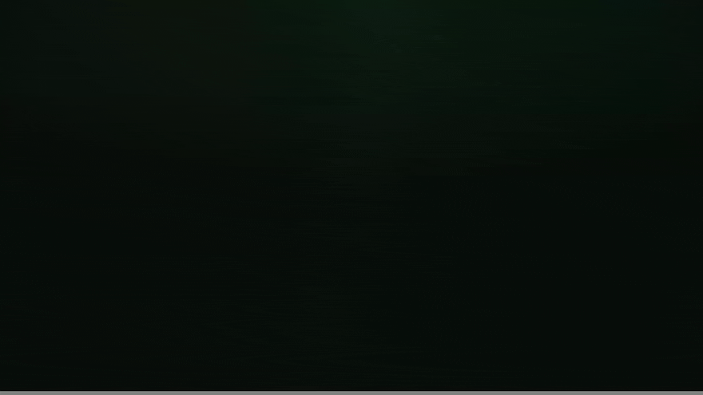
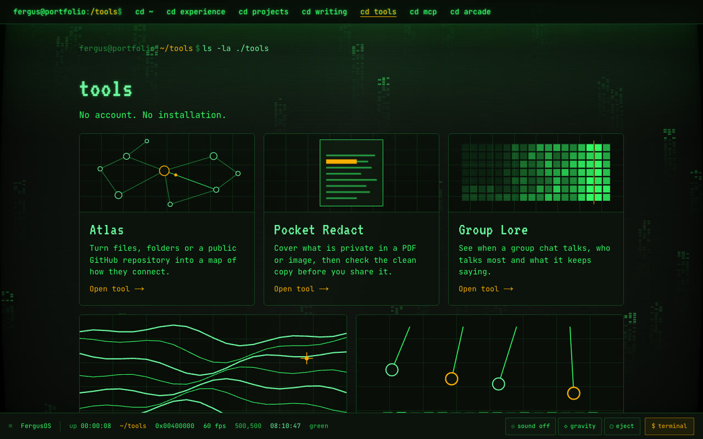
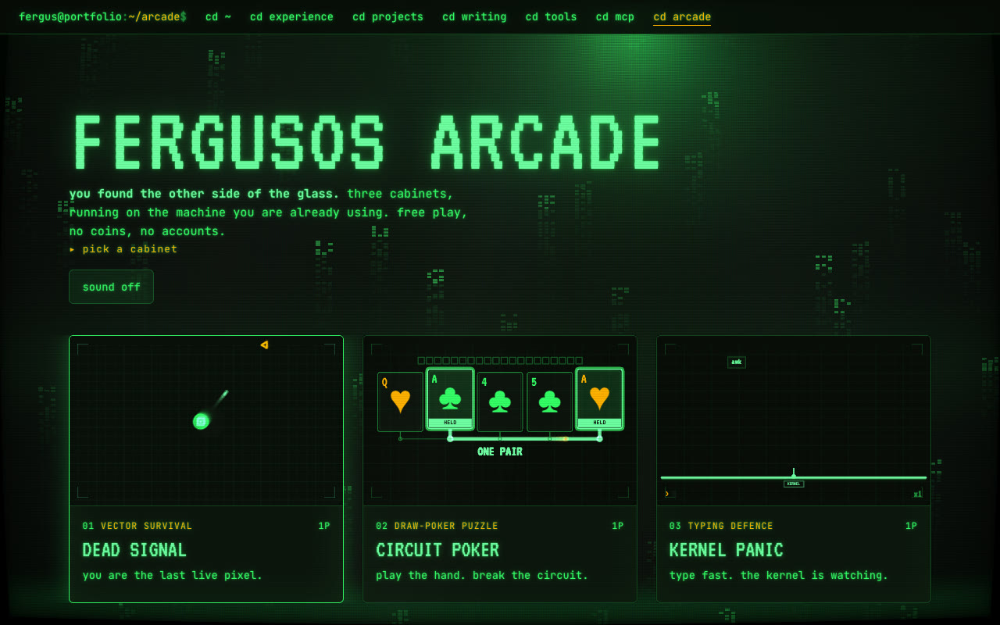

# FergusOS

My website, built as a cathode ray tube that boots. Live at **[fergusoreilly.dev](https://fergusoreilly.dev)**.

<a href="https://fergusoreilly.dev"></a>

<sub>Recorded on the live site. The BIOS is reading the machine that's looking at it, which here was a headless browser.</sub>

It's a portfolio, but it's also a machine you can play with:

- **It boots.** The BIOS reads your own CPU cores, memory, display and locale, then the beam traces the site's mark in one stroke. Leave it idle and the beam draws an oscilloscope figure.
- **There's a real terminal.** Open it from the bar at the bottom of any page, or use the one under About. `cd`, `ls` and `cat` take you round the site. Then try `neofetch`, `degauss`, `matrix` or `sudo`.
- **There are useful tools.** No account, no install. Atlas maps a folder or a public GitHub repo. Pocket Redact covers what's private in a PDF or image. Group Lore works out when a group chat talks and who talks most. Relief turns a year of activity into a landscape. Resonance is a four-voice synth with a sixteen-step sequencer.
- **There's an arcade behind the glass.** Three cabinets, free play, high scores: Dead Signal, Circuit Poker and Kernel Panic.
- **It's an MCP server.** Point an agent at `https://fergusoreilly.dev/api/mcp` and it can read the writing, projects and experience as data instead of scraping a page pretending to be a TV.
- **You can ask me for a coffee.** The Contact page offers 30-minute weekday windows, I confirm by email, and the form works with JavaScript turned off.

<table>
<tr>
<td><a href="https://fergusoreilly.dev/tools"></a></td>
<td></td>
</tr>
</table>

## Run it

```sh
npm ci
npm run dev
```

Next.js 15, React 19, TypeScript and hand-written CSS, with no CSS framework. The phosphor themes, the glass and the machine chrome all live in `app/globals.css`, and it respects reduced motion.

The words are in `content/`, the images are built by `scripts/build-images.mjs`, and the house rules are in [`AGENTS.md`](AGENTS.md). Tests, the verification scripts, the meeting form and deploying are in [`docs/DEVELOPING.md`](docs/DEVELOPING.md).

```sh
npm test
npm run build
```

Changes go through a pull request. `main` deploys to fergusoreilly.dev.
